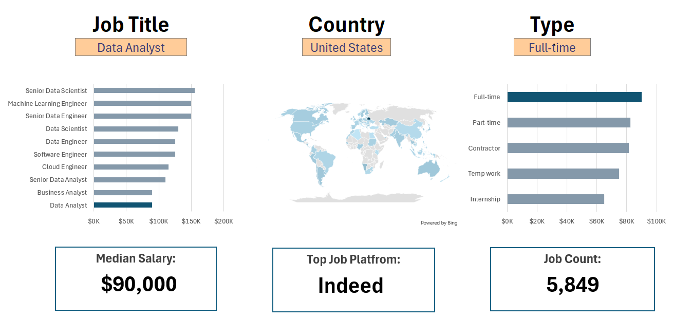
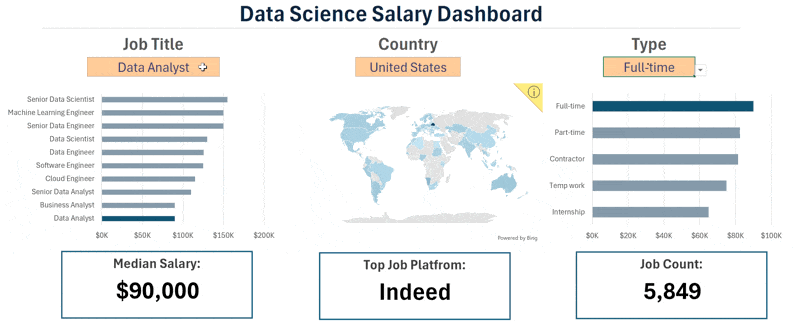
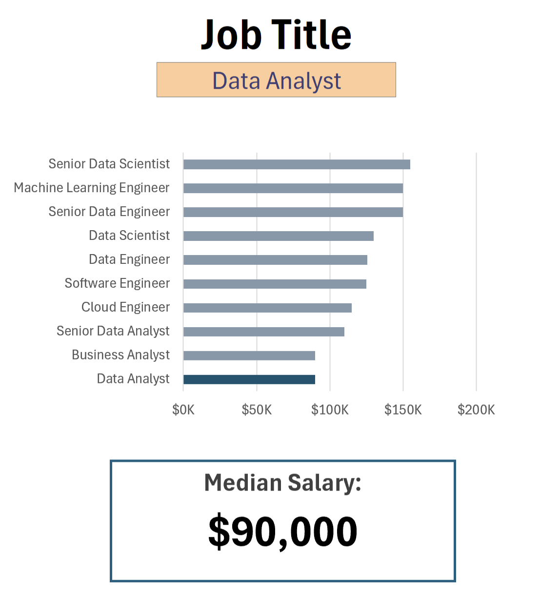
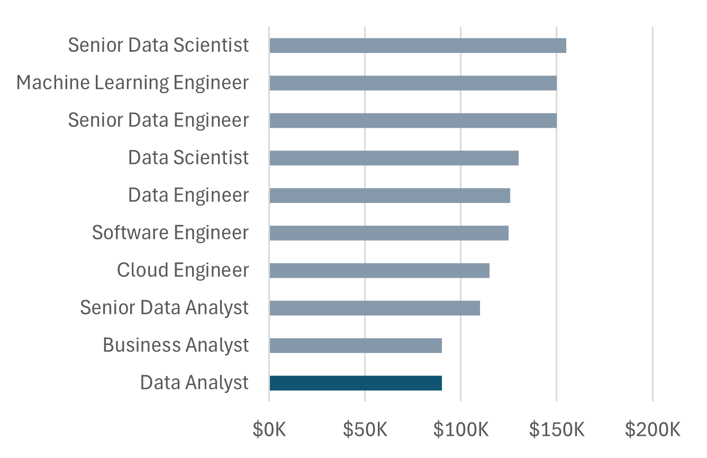
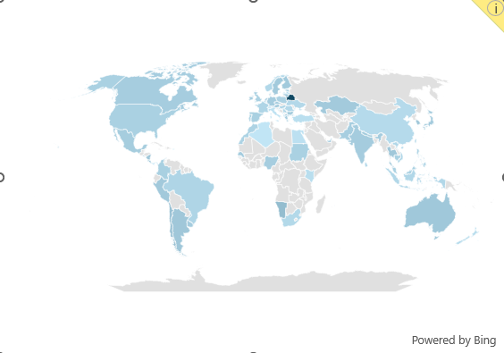
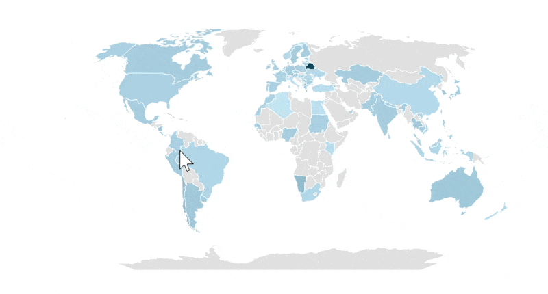
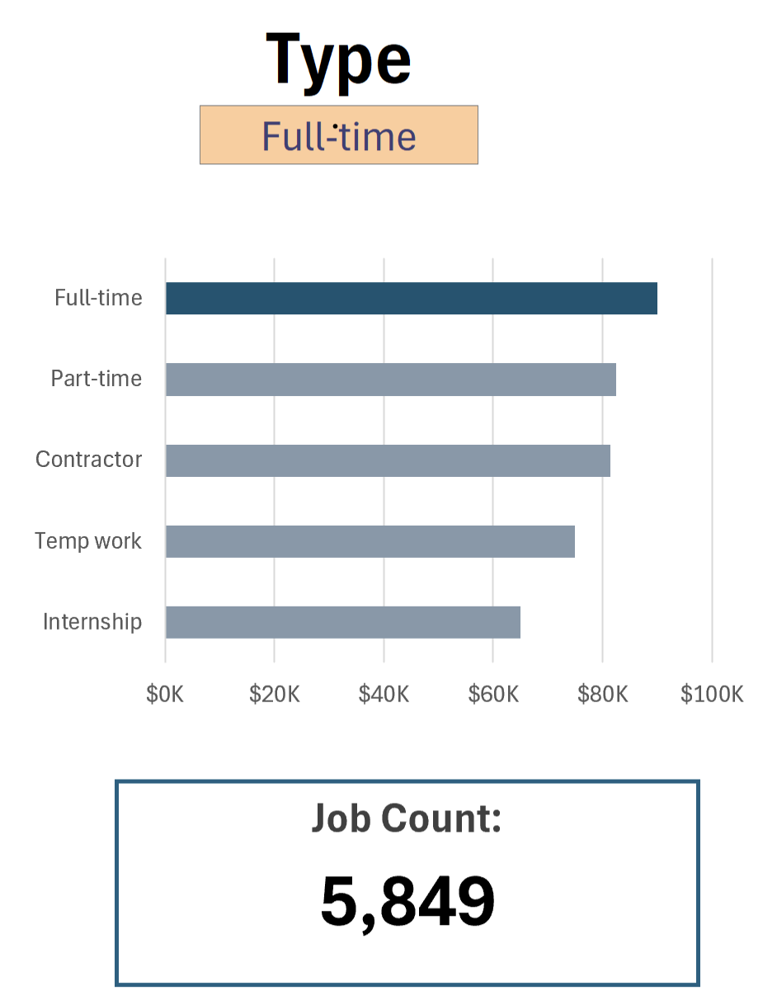
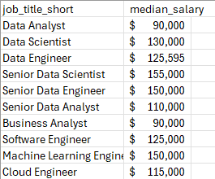
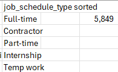

# Project 1, Salary Dashboard

File: [`1_Salary_Dashboard.xlsx`](1_Salary_Dashboard.xlsx)

A single page, interactive dashboard for exploring data science job postings by job title, country, and employment type. Selecting a value updates every chart and summary tile on the sheet at once.

[Back to main README](../README.md) | [Project 2, Project Analysis](../Project2-Analysis/README.md)

## Full Dashboard

For the filter combination shown (Data Analyst, United States, Full-time), the dashboard reports a median salary of $90,000, Indeed as the top platform, and 5,849 matching postings. The three panels update together from a single set of filters, so every number on the page always refers to the same filtered slice of the dataset.

This recording shows the full dashboard responding live as the filters change, with the ranked chart, map, and summary tiles all recalculating at once.

## Median Salary by Job Title

The ranked bar chart shows a clear salary ladder: Senior Data Scientist tops the list at roughly $155,000, with Machine Learning Engineer and Senior Data Engineer close behind at about $150,000. Data Analyst and Business Analyst sit at the bottom of this list at roughly $90,000, a little under half the top salary. The selected title is always drawn in dark teal so it stands out against the rest of the ranking.

## Job Postings by Country

The map shades every country that has at least one posting matching the current filters, with the selected country marked in dark teal. Postings are concentrated in the United States but appear across a wide spread of countries in the Americas, Europe, and parts of Africa and Asia, showing this is a dataset of a genuinely global job market rather than a single region.

## Job Count by Employment Type

Full-time postings clearly dominate the employment type breakdown, well ahead of Part-time, Contractor, Temp work, and Internship. This chart uses a secondary count based measure rather than salary, so it answers a different question from the title and country panels: not how much a role pays, but how common that way of working is.

## Supporting Calculations

The dashboard's summary tiles and charts are driven by helper sheets that recalculate the moment a selection changes.

This is the underlying lookup table behind the job title chart: one median salary figure per job title, calculated directly from the raw dataset rather than hardcoded, so the chart always reflects the current data.

The equivalent table for employment type, sorted so that Full-time (the largest category, at 5,849 postings) appears first and feeds the highlighted bar in the Type chart.

These helper sheets (`Jobs`, `Country`, `Type`, `Platform`) use array formulas such as `MEDIAN(IF(...))`, along with `XLOOKUP` and `COUNTIFS`, to calculate conditional medians and counts for whatever job title, country, and type are currently selected. The selections themselves are stored as named cells (`title`, `country`, `type`), so every formula on the sheet reads from the same source and stays in sync.

## Summary Tiles

- **Median Salary**: the median `salary_year_avg` for the current filter combination
- **Top Job Platform**: the job board (`job_via`) with the most postings for the current filter combination
- **Job Count**: the total number of postings matching the current filter combination

[Back to main README](../README.md) | [Project 2, Project Analysis](../Project2-Analysis/README.md)
