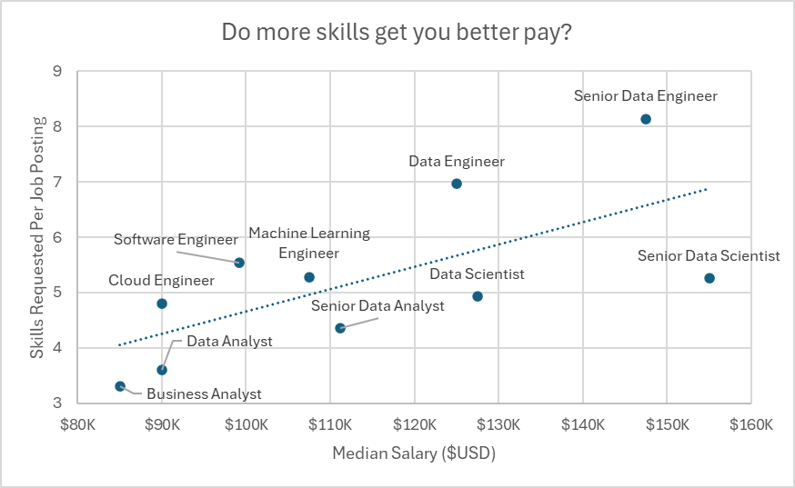
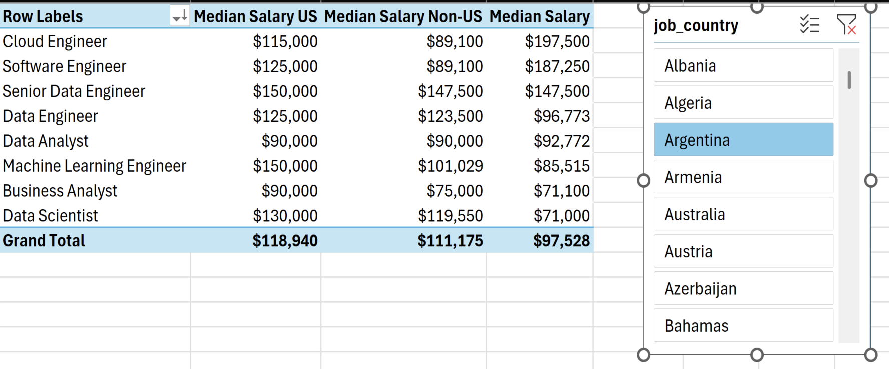
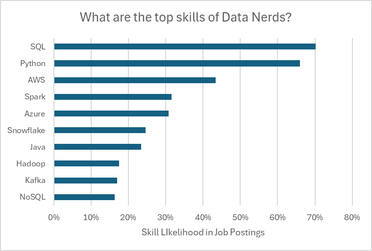
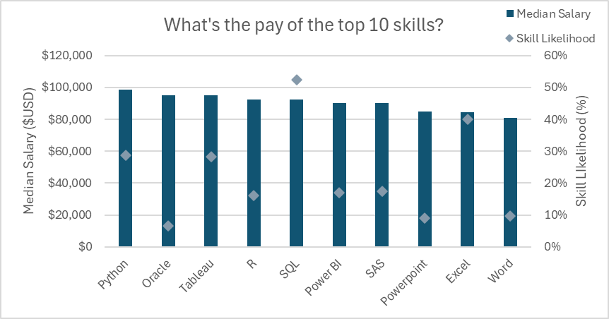
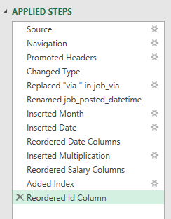
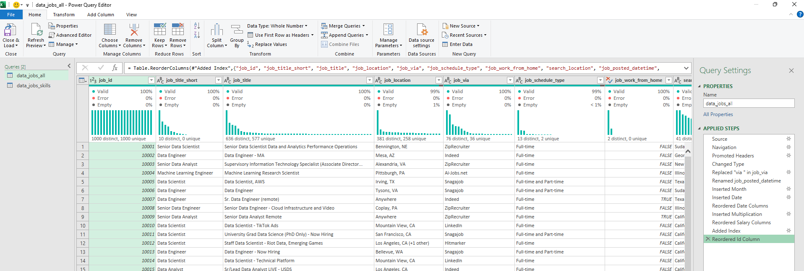
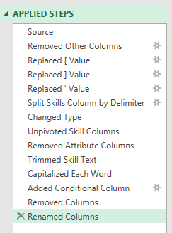
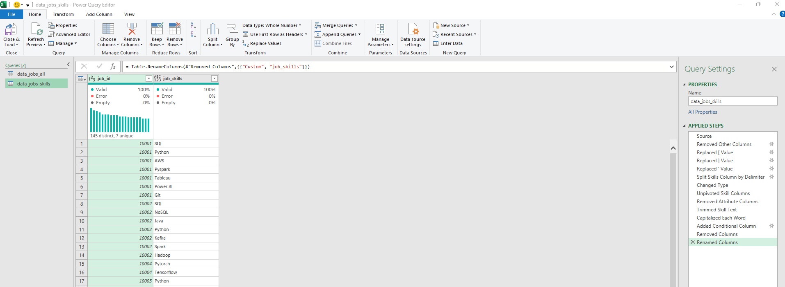
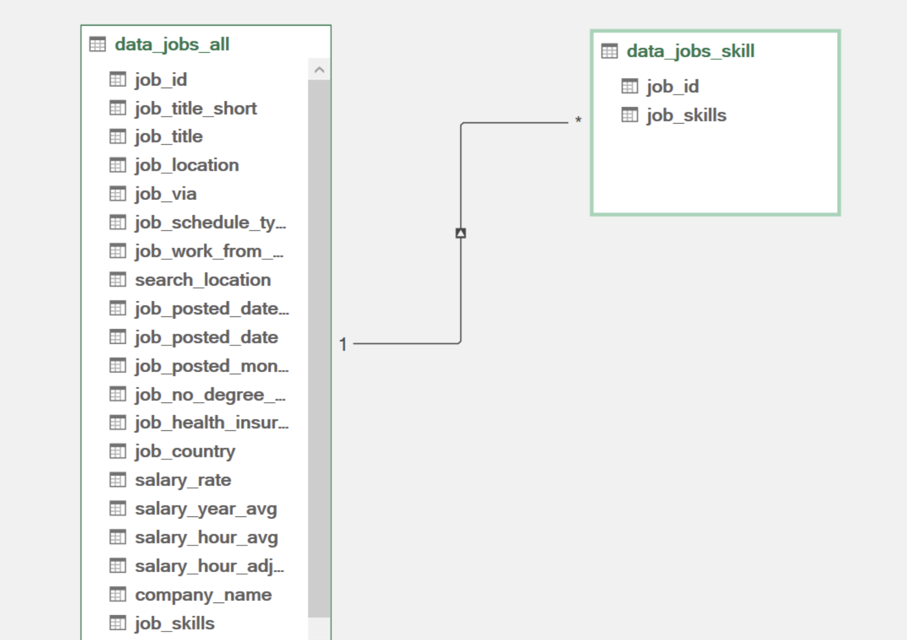
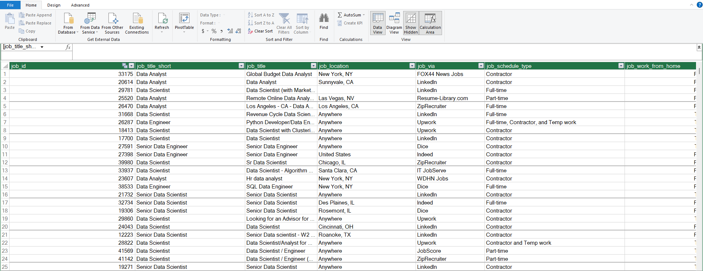

# Project 2, Project Analysis

File: [`1_Project_Analysis.xlsx`](https://github.com/chaganty18/Excel_Dashboards_Analysis/blob/main/Project2-Analysis/1_Project_Analysis.xlsx)

Four PivotTable based analyses of the same job postings dataset, each on its own sheet, looking at salary against skills, region, and platform.

[Back to main README](https://github.com/chaganty18/Excel_Dashboards_Analysis/blob/main/README.md) | [Project 1, Salary Dashboard](https://github.com/chaganty18/Excel_Dashboards_Analysis/blob/main/Project1-Dashboard/README.md)

## Salary vs Skills

A scatter plot, "Do more skills get you better pay?", plotting median salary against the average number of skills requested per job posting for each job title, with a trend line showing the overall relationship. The trend is generally upward, but Senior Data Engineer is a clear outlier, requesting the most skills per posting (around 8) despite paying somewhat less than Senior Data Scientist. Senior Data Scientist has the highest salary of the group but a comparatively moderate skill count, showing that more requested skills does not guarantee the very top salary. Business Analyst and Data Analyst sit at the lower end on both measures.

## Salary Analysis, US vs Non-US

A PivotTable and slicer comparing median salary across US, non US, and all countries, broken down by job title. In this view the `job_country` slicer is set to Argentina, which is why the "Median Salary" column differs from both the US and Non-US columns for several roles. For most titles the US median sits above the non US median, for example Data Engineer ($125,000 US versus $123,500 non US) and Business Analyst ($90,000 US versus $75,000 non US), though Senior Data Engineer is close to even between the two.

## Top Skills by Job Title

A bar chart, "What are the top skills of Data Nerds?", showing how often each skill appears across job postings for a selected job title, controlled by job title and country slicers. SQL and Python are requested far more often than anything else, at roughly 70 percent and 66 percent of postings, with a steep drop to AWS at around 43 percent. The remaining skills (Spark, Azure, Snowflake, Java, Hadoop, Kafka, NoSQL) trail off gradually from there, suggesting SQL and Python are close to baseline expectations while the rest are more specialized, differentiating skills.

## Pay of the Top Skills

A combination chart, "What's the pay of the top 10 skills?", showing median salary and skill likelihood together for the ten most common skills. Python combines the highest median salary of the group (close to $100,000) with a solidly high likelihood (around 29 percent). SQL is requested far more often than any other skill (around 52 percent likelihood) but sits mid pack on pay. General office tools, Word and PowerPoint, have both the lowest likelihood and the lowest median salary in the group, hinting that postings leaning on database and programming skills tend to pay more than those built around general office software.

## Data Preparation, Power Query

Both source tables were cleaned and shaped in Power Query before being loaded into the Excel Data Model.

### Jobs table, data_jobs_all

The applied steps list documents the full cleaning pipeline in order: promoting headers, fixing data types, cleaning the `job_via` text, renaming and splitting the posted date, adding a salary calculation, reordering columns, and adding an index. Because every step is recorded, the whole transformation can be re-run automatically whenever the source data refreshes.

The column quality bars at the top of the editor (Valid, Error, Empty) confirm the cleaned columns are essentially free of errors, with `job_title` and `job_via` being the only columns carrying a small number of empty or error values after cleaning.

- Promoted headers and set column data types
- Cleaned the `job_via` column by removing the leading "via " text
- Renamed and split the posting date into separate month and date columns
- Added a calculated salary column to make hourly and yearly figures comparable
- Reordered columns and added an index for a clean, readable layout

### Skills table, data_jobs_skills

This query's steps show a text parsing pipeline: stripping bracket and quote characters left over from a Python style list, splitting that list into separate columns, then unpivoting so each skill gets its own row, followed by cleanup steps like trimming and capitalizing skill names.

The result is a simple two column table, `job_id` and `job_skills`, with around 145 distinct skills across the dataset. This long, narrow shape is what makes it possible to count or filter by individual skill later on.

- Removed unused columns and stripped stray brackets and quote characters from the raw skills field
- Split the skills column by delimiter, then unpivoted it so each row represents one job and one skill
- Trimmed whitespace, capitalized skill names consistently, and removed helper columns
- Renamed the final column to `job_skills`

## Data Model

The two cleaned tables are linked in the Excel Data Model through a one to many relationship on `job_id`.

The 1 to many relationship (one job in `data_jobs_all` to many rows in `data_jobs_skill`) is what allows a single job posting with, say, seven listed skills to contribute seven rows to the skills table while still only counting once in job level totals. This is the structural piece that makes the Top Skills and Pay of the Top Skills charts possible without duplicating salary data.

The Power Pivot data view confirms the full `data_jobs_all` table loaded into the model, ready to be summarized with PivotTables and related to the skills table shown above.

[Back to main README](https://github.com/chaganty18/Excel_Dashboards_Analysis/blob/main/README.md) | [Project 1, Salary Dashboard](https://github.com/chaganty18/Excel_Dashboards_Analysis/blob/main/Project1-Dashboard/README.md)
